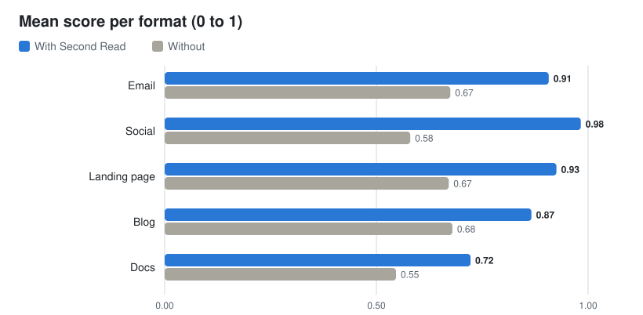

<h1 align="center">Second Read</h1>

<p align="center">
  
  
  
</p>

A lot of technical founders I know can build the product and then stall on
the writing around it. That writing is most of what gets a product out. The
copy brings people in: the launch post, the landing page, the email. The
documentation shows them the value and helps them adopt it: how to install
it, use it, fix it when it breaks, and adapt it to their own case. Both fail
in small, checkable ways. A weekday that does not match its date. A "50%
off" that is really a third. A tutorial step that uses a file no earlier
step created. A #ad buried under eleven hashtags. A button that says
"Submit".

Second Read is the colleague you send it to before you hit send. It reads
the piece twice, quotes each problem, names the rule it breaks, leaves
correct details alone, and hands it back with three to five fixes and a
rewrite that adds nothing you did not say.

<p align="center">
  <em>Read it twice. Send it once.</em>
</p>

<p align="center">
  <picture>
    <source media="(prefers-color-scheme: dark)" srcset="assets/benchmark-hero-dark.svg">
    
  </picture>
</p>

<p align="center">
  <strong>Planted problems found: <!--RECALL_WITH-->99%<!--/RECALL_WITH--> of runs with Second Read.</strong> Without: <!--RECALL_WITHOUT-->89%<!--/RECALL_WITHOUT-->.<br>
  <strong>Rewrites with no invented fact: <!--NOFAB_WITH-->95%<!--/NOFAB_WITH-->.</strong> Without: <!--NOFAB_WITHOUT-->62%<!--/NOFAB_WITHOUT-->.<br>
  <sub>Claude Haiku in Claude Code, the same agent with and without the plugin: <!--CASE_COUNT-->39<!--/CASE_COUNT--> pieces (emails, social posts, landing pages, blog posts, docs pages), <!--RUNS-->3<!--/RUNS--> runs per arm. Synthetic cases; <a href="#limits">limits below</a>.</sub>
</p>

The clearest result: without Second Read, Haiku called 0 of 15 clean
controls clean. With it, <!--CONTROL_WITH-->67%<!--/CONTROL_WITH--> of those runs were called clean.

It is a prompt, packaged for Claude Code and other agents. Personal project.

---

## Numbers

<p align="center">
  <picture>
    <source media="(prefers-color-scheme: dark)" srcset="assets/benchmark-formats-dark.svg">
    
  </picture>
</p>

| Share of runs that pass | With Second Read | Without |
|---|--:|--:|
| Planted flaws found (80% or more of them, with evidence) | <!--RECALL_WITH-->99%<!--/RECALL_WITH--> | <!--RECALL_WITHOUT-->89%<!--/RECALL_WITHOUT--> |
| Send- or publish-blocking flaws ranked first, with a "do not send" verdict | <!--GATE_WITH-->97%<!--/GATE_WITH--> | <!--GATE_WITHOUT-->85%<!--/GATE_WITHOUT--> |
| Correct details (decoys) left alone | <!--DECOY_WITH-->85%<!--/DECOY_WITH--> | <!--DECOY_WITHOUT-->52%<!--/DECOY_WITHOUT--> |
| Rewrites with no invented fact (share of rewrites, checked by script) | <!--NOFAB_WITH-->95%<!--/NOFAB_WITH--> | <!--NOFAB_WITHOUT-->62%<!--/NOFAB_WITHOUT--> |
| Clean controls called clean | <!--CONTROL_WITH-->67%<!--/CONTROL_WITH--> | <!--CONTROL_WITHOUT-->0%<!--/CONTROL_WITHOUT--> |
| Mean score (0 to 1) | <!--SCORE_WITH-->0.88<!--/SCORE_WITH--> | <!--SCORE_WITHOUT-->0.63<!--/SCORE_WITHOUT--> |

<!--CASE_COUNT-->39<!--/CASE_COUNT--> cases, <!--RUNS-->3<!--/RUNS--> runs per case per arm, <!--RUN_TOTAL-->234<!--/RUN_TOTAL--> runs in
all, measured on <!--RESULTS_DATE-->2026-10-17<!--/RESULTS_DATE-->. Each case is a realistic piece from a
fictional brand or product with 3-6 planted flaws a reviewer can check
objectively (a count, a calendar, a sum, two places that disagree), one to
three decoys a careless reviewer flags, and a list of the original's facts.
Every prompt asks for the fix as one fenced code block, in both arms, and
[benchmarks/check_facts.py](benchmarks/check_facts.py) counts any number,
price, date, link or code span in it that the original does not have. One
clean control per format checks that good work is left alone. Per-format tables, run counts and per-case
scores are in [benchmarks/results/](benchmarks/results/); the method is in
[benchmarks/METHOD.md](benchmarks/METHOD.md).

## Before / after

A synthetic benchmark fixture: case
[`sr-social-03`](benchmarks/cases/sr-social-03/), run 1 of each arm, same
model (Haiku), same prompt. An Instagram caption for a paid skincare
partnership. Full reports: [examples/sr-social-03.md](examples/sr-social-03.md).

**The original** (relevant lines):

```
Okay so you guys know I've been SO busy lately with the move and everything ...
Enter the Dewlight Barrier Balm. I've used it every night for two weeks and it
cleared my eczema in 3 days. Like, actually gone. 🙌
Shop it at https://dewlightskin.com/balm and use my code JUNI15 ...
#skincare #skincareroutine #eczema ... #skincarecommunity #ad
```

**Without Second Read** (score 0.38), it caught the two loud problems:

> **Verdict: do not post as written.** ... The only disclosure is `#ad`, the last of 12 hashtags ...
>
> "it cleared my eczema in 3 days. Like, actually gone." An eczema claim is a medical condition claim.

It missed the two quiet ones: a caption URL cannot be tapped on Instagram,
and the product is not named before the "more" cut. Its rewrite keeps both
(the balm first named at character 284, the link still in the caption) and
adds a claim the creator never made:

```
#ad Paid partnership with Dewlight Skin. I earn a commission when you use my code.
Okay so you guys know I've been SO busy lately with the move ...
... every night for two weeks and my skin feels so much calmer and more comfortable. 🙌
```

"Calmer and more comfortable" has no number in it, so `check_facts.py` does
not count it; the Haiku judge failed this rewrite for invented facts.

**With Second Read** (score 1.00), all four planted flaws, including:

> **Verdict: Do not send · 30/100**
>
> 1\. **Blocker · S10 Health claim.** "it cleared my eczema in 3 days. Like, actually gone." ...
>
> 3\. **Major · S2 Hook position.** "Enter the Dewlight Barrier Balm" starts after the "more" cut (about 125 characters).
>
> 4\. **Major · S4 Link placement.** ... a URL in an Instagram caption, which is not clickable.

```
Paid partnership with Dewlight Skin. I've been using the Dewlight Barrier Balm every night for two weeks.
[Your honest experience with the balm, in your own words. No cure, treatment or medical claims.]
Get it with my code JUNI15 for 15% off until 30 November, 23:59 GMT. Link in bio: [confirm bio link goes to https://dewlightskin.com/balm].
```

## What it checks

**Copy.** Eleven checks for every format: the facts agree (sums, weekdays,
dates, names); the point comes first; one message; one primary call to
action with a specific label; proof for claims; honest urgency and pricing;
compliance (unsubscribe link, ad disclosure, giveaway rules, risk warnings);
fit for the reader's stage; brand voice; plain writing; nothing unfinished.
Then the hard checks for the format:

- **Email:** subject length and spam triggers, preheader, sender, postal
  address, word budget per email type, bare or shortened links, send time.
- **Social (X, LinkedIn, Instagram, Facebook):** character limits (an X link
  counts as 23), the point before the "see more" cut, hashtag counts, paid
  disclosure before the cut, giveaway rules, engagement bait.
- **Landing page:** match with the ad that sends traffic, the H1, what sits on
  the first screen, form fields, one price, broken anchors, title tag and
  meta description.
- **Blog:** the title's promise is kept ("7 ways" needs seven), heading
  structure, numbers that compute, sourced stats, affiliate disclosure.

**Docs.** The page is classified by what it does, not by its title:
tutorial, how-to guide, reference or explanation, after
[Diátaxis](https://diataxis.fr). Then three groups of checks:

- **Accuracy:** facts agree across the page, steps run in order,
  prerequisites come first, examples match the reference table, the last step
  shows a result, nothing unfinished, a warning before anything destructive.
- **Mode mixing:** a tutorial that offers choices, a how-to that stops to
  teach theory, reference that gives advice, an explanation with steps to
  run, a label that promises one type and delivers another.
- **Style:** second person, active voice, sentence case headings,
  descriptive links, code you can copy and run, one term per thing,
  inclusive language and alt text, after the
  [Ubuntu documentation style guide](https://documentation.ubuntu.com/style-guide/).

READMEs, API pages and release notes get their own checklists on top.

## How it works

1. **Fact ledger first.** Before judging anything, it lists every price,
   date, name, link, command, version and claim in the original, verbatim.
   The arithmetic and calendar checks run on that list, and the rewrite may
   use only what is on it.
2. **Decoy guard.** Before a problem goes in the fix list, it quotes the
   text, names the rule and threshold, and re-checks (recount, recompute). If
   the text passes the rule, it is not a fix. Good work gets "Ready to send"
   with at most two optional notes.
3. **Ranked fixes.** Three to five, Blockers first (compliance, wrong facts,
   unfinished work, unsafe steps), then Majors by what they cost the goal,
   Minors last. Each fix has a severity, a rule, a quote, what it costs, and
   the change.
4. **Verdict.** Any Blocker: Do not send (or Do not publish). Any Major: Fix
   first. Otherwise Ready to send. A score from 100 down.
5. **Rewrite that invents nothing.** Missing facts become `[placeholders]`,
   conflicting ones become `[confirm: X or Y]`, and every number, date and
   claim in the rewrite is listed against the ledger before you see it.

The prompt is two skills, [`skills/second-read/SKILL.md`](skills/second-read/SKILL.md)
(copy) and [`skills/docs/SKILL.md`](skills/docs/SKILL.md) (docs), each with
reference files. The compact version for agents that read a rules file is
[`AGENTS.md`](AGENTS.md). [docs/COVERAGE.md](docs/COVERAGE.md) and
[docs/COVERAGE-docs.md](docs/COVERAGE-docs.md) trace each check to its
source.

## Install

**Claude Code**, as two separate prompts:

```
/plugin marketplace add C-Kapsalis/second-read
```
```
/plugin install second-read@second-read
```

Then share a draft and ask: "Can you give this a second read before I send
it?" The Code tab of the Claude Desktop app works the same way.

**Claude (web and Desktop chat):** add the marketplace
`C-Kapsalis/second-read` under Customize > Plugins, or upload
`second-read-plugin.zip` there, or upload the two skill zips under
Customize > Skills. Code execution must be on. There is no session hook in
chat, so say "give this a second read" and the skill loads from its
description. Menu labels may differ in your version.

**ChatGPT:** upload the two skill zips (Plugins > Skills), or use the custom
GPT or Project instructions in [adapters/chatgpt/](adapters/chatgpt/) as a
fallback. Untested; a public listing in OpenAI's directories is the
publisher's choice, see [PUBLISHING.md](PUBLISHING.md).

**Codex, Copilot, Gemini CLI, OpenCode, Cursor, Windsurf, Cline, Kiro,
OpenClaw** and anything that reads `AGENTS.md`: step by step in
**[INSTALL.md](INSTALL.md)**, with what I have and have not tested. The
release zips are built by `sh scripts/package.sh`.

## The benchmark

The cases live in [benchmarks/cases/](benchmarks/cases/) in the format
`claude plugin eval` reads. They are generated from three answer sheets in
[benchmarks/builder/](benchmarks/builder/), and
`python3 benchmarks/builder/build_all.py` rebuilds them byte for byte. To run
it yourself:

```bash
claude plugin eval . --eval-dir benchmarks/cases --scaffold --allow-tools Write Bash --model haiku -j 6 --runs 3 --trust-plugin --no-publish --keep-temp | tee benchmarks/eval.log
python3 benchmarks/check_facts.py benchmarks/eval.log --json benchmarks/results/facts.json
python3 benchmarks/report.py benchmarks/eval.log --facts benchmarks/results/facts.json
```

The second command checks every rewrite for invented facts without a model;
the third writes the results page, redraws the charts and fills the numbers
in this README. What each grader checks, and why Haiku:
[benchmarks/METHOD.md](benchmarks/METHOD.md).

## Limits

- **Synthetic cases.** Every piece was written for the benchmark with flaws
  planted on purpose. Real drafts are messier, and much of what makes copy
  good (is the offer worth it?) cannot be checked this way.
- **Small n.** <!--RUNS-->3<!--/RUNS--> runs per case per arm. One run moves a case's pass
  rate by a third. Read differences of a few points as noise.
- **A small judge.** Claude Haiku grades flaws, ranking, decoys and
  controls, three votes per grader, majority wins. Split votes show up in
  the log. I have not yet measured agreement with a human grader. Invented
  facts are counted by a script, which sees numbers, links and code but not
  a new claim in words.
- **Where it did worse.** On blog posts it found 94% of planted flaws
  against 100% without: one missed flaw. Docs is the weakest format (mean
  score 0.72), and only 1 of 3 docs control runs was called clean.
- **One model, one host.** The numbers are for Haiku in Claude Code. The
  other adapters load the same prompt but are not benchmarked.
- **It checks the page, not the product.** For docs, it can tell you two
  steps disagree; it cannot run your commands. For copy, it can tell you a
  price is inconsistent; it cannot tell you the right one.
- **Same author.** I wrote the cases and the prompt. Cases from other people
  would make the numbers more trustworthy.

If you have a draft where Second Read got it wrong, a flaw it should have
caught, or a decoy it should have left alone, please
[open an issue](https://github.com/C-Kapsalis/second-read/issues). A
counterexample is worth more to me than a star. See
[CONTRIBUTING.md](CONTRIBUTING.md).

## Credits

- The docs skill's four page types and mode-mixing checks follow
  [Diátaxis](https://diataxis.fr) by Daniele Procida, licensed
  [CC BY-SA 4.0](https://creativecommons.org/licenses/by-sa/4.0/).
  [`skills/docs/references/diataxis.md`](skills/docs/references/diataxis.md)
  paraphrases it in my own words and adds review checks; read the original
  for the full argument.
- The docs style rules take Canonical's
  [Ubuntu documentation style guide](https://documentation.ubuntu.com/style-guide/)
  (CC BY-SA) as the house baseline, paraphrased in
  [`skills/docs/references/style.md`](skills/docs/references/style.md),
  alongside points from the Google developer documentation style guide and
  the Microsoft Writing Style Guide.
- The repository layout and the multi-agent adapters follow
  [Ponytail](https://github.com/DietrichGebert/ponytail) by Dietrich Gebert.

Personal project. It is not affiliated with, or endorsed by, any employer.

## License

[MIT](LICENSE). Diátaxis and the Ubuntu style guide keep their own licenses;
this repository paraphrases them and copies no text from them.
