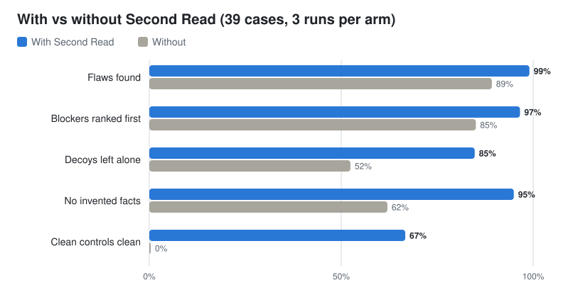

<h1 align="center">Second Read</h1>

<p align="center">
  
  
  
</p>

Technical founders build great products, yet adoption often stalls
because of poor communication. Clear public writing (read by both
humans and AI agents) remains one of the most effective ways to bring 
technical work to a wider audience and communicate its value.

This writing drives discovery and inbound interest through launch posts, 
landing pages, emails, and other public-facing content.

But technical communication goes well beyond marketing. **Documentation 
is especially important because it makes a product's value tangible.** 
It shows the problems a solution solves, the use cases it supports, 
and how it fits into real-world workflows.

And once someone decides to try the product, documentation becomes 
essential to adoption. It guides users through integrating it into 
their existing stack, using it in their workflows, troubleshooting 
unexpected results, and adapting it to their specific needs.

Both marketing content and technical documentation can fail in small, 
verifiable ways, often with outsized consequences.

A launch post announces that a feature is available to everyone, but 
ends with a link to a waitlist. A pricing page promises a 40% discount, 
while the numbers show only 20%. A five-minute quickstart references an 
environment variable it never tells users to define. An API tutorial uses 
a parameter name that contradicts its own schema. A troubleshooting guide 
points to a configuration option that doesn't exist in the documented setup.

None of these mistakes requires a complete rewrite. But each can cost you 
a potential user, undermine trust, or leave a developer stuck halfway through
an integration.

**SecondRead is the colleague you send your writing to before you hit publish.** 
It reads the piece twice, quotes each problem, identifies the rule it breaks, 
and leaves correct details untouched. Then it hands back three to five actionable
fixes and a clean rewrite that adds nothing you didn't say.


<p align="center">
  <em>Read it twice. Send it once.</em>
</p>

<p align="center">
  <picture>
    <source media="(prefers-color-scheme: dark)" srcset="assets/benchmark-hero-dark.svg">
    
  </picture>
</p>

<p align="center">
  <strong>Planted-flaw check passed: <!--RECALL_WITH-->99%<!--/RECALL_WITH--> with SecondRead; <!--RECALL_WITHOUT-->89%<!--/RECALL_WITHOUT--> without.</strong><br>
  <strong>Rewrites with no invented facts: <!--NOFAB_WITH-->95%<!--/NOFAB_WITH--> with SecondRead; <!--NOFAB_WITHOUT-->62%<!--/NOFAB_WITHOUT--> without.</strong><br>
  <sub>Same Claude Haiku agent in Claude Code, with and without the plugin. Controlled cases across emails, social posts, landing pages, blogs and technical docs, drawing on public-facing writing and problems I encountered in professional work. The published test pieces use fictional brands, planted flaws and clean controls. <a href="#the-benchmark">Method</a> and <a href="#interpreting-the-results">evaluation notes</a> below.</sub>
</p>

The clearest result is about restraint. Without SecondRead, Haiku did not recognize any of the clean controls as clean. With it, <!--CONTROL_WITH-->67%<!--/CONTROL_WITH--> were correctly called clean. It also left correct details alone more often: <!--DECOY_WITH-->85%<!--/DECOY_WITH--> versus <!--DECOY_WITHOUT-->52%<!--/DECOY_WITHOUT--> without the plugin.

**Why Haiku?** Because reliable work should not always require a bigger
model. SecondRead tests whether explicit rules and a structured review
process can make a lightweight model more dependable for everyday
professional writing. This first benchmark focuses on review quality;
workflow capacity and cost are natural next measures.

It is a prompt, packaged for Claude Code and other agents. Personal project.

---

## What we tested

The benchmark covers five public-facing formats: **email, social posts,
landing pages, blog posts and technical documentation**. The test pieces
adapt real-world problems into controlled scenarios, using fictional
brands so individual checks can be scored consistently.

The scenarios probe the mistakes that affect whether a piece can be
published or followed:

- **Facts and promises:** dates and weekdays that disagree, arithmetic
  that does not add up, conflicting prices or names, and claims the
  piece itself does not support.
- **Marketing execution:** calls to action, offer consistency,
  disclosures, and format-specific constraints such as where a link or
  important message appears.
- **Documentation accuracy:** missing prerequisites, steps in the wrong
  order, examples that disagree with their reference, and instructions
  that leave the reader stuck.
- **False positives:** deliberately correct details that might look
  suspicious, to test whether the reviewer can leave them alone.
- **Clean controls:** already-correct pieces, to test whether the
  reviewer can say "ready to send" instead of inventing edits.

Five outcomes are scored: whether the reviewer **finds planted flaws
with evidence, ranks publish-blocking mistakes first, leaves decoys
alone, rewrites without adding facts, and recognizes clean work**.
These are the benchmarked behaviors. The more extensive rules SecondRead
applies to each format are listed under [What it checks](#what-it-checks).

## Numbers

| Share of runs that pass | With Second Read | Without |
|---|--:|--:|
| Planted flaws found (80% or more of them, with evidence) | <!--RECALL_WITH-->99%<!--/RECALL_WITH--> | <!--RECALL_WITHOUT-->89%<!--/RECALL_WITHOUT--> |
| Send- or publish-blocking flaws ranked first, with a "do not send" verdict | <!--GATE_WITH-->97%<!--/GATE_WITH--> | <!--GATE_WITHOUT-->85%<!--/GATE_WITHOUT--> |
| Correct details (decoys) left alone | <!--DECOY_WITH-->85%<!--/DECOY_WITH--> | <!--DECOY_WITHOUT-->52%<!--/DECOY_WITHOUT--> |
| Rewrites with no invented facts (share of rewrites, checked by script) | <!--NOFAB_WITH-->95%<!--/NOFAB_WITH--> | <!--NOFAB_WITHOUT-->62%<!--/NOFAB_WITHOUT--> |
| Clean controls called clean | <!--CONTROL_WITH-->67%<!--/CONTROL_WITH--> | <!--CONTROL_WITHOUT-->0%<!--/CONTROL_WITHOUT--> |
| Mean score (0 to 1) | <!--SCORE_WITH-->0.88<!--/SCORE_WITH--> | <!--SCORE_WITHOUT-->0.63<!--/SCORE_WITHOUT--> |

## Before / after

A synthetic benchmark fixture: case
[`sr-social-03`](benchmarks/cases/sr-social-03/), run 1 of each arm, same
model (Haiku), same prompt. An Instagram caption for a paid skincare
partnership. Full reports: [examples/sr-social-03.md](examples/sr-social-03.md).

**The original** (relevant lines):

```
Okay so you guys know I've been SO busy lately with the move and everything ...
Enter the Dewlight Barrier Balm. I've used it every night for two weeks and it
cleared my eczema in 3 days. Like, actually gone. 🙌
Shop it at https://dewlightskin.com/balm and use my code JUNI15 ...
#skincare #skincareroutine #eczema ... #skincarecommunity #ad
```

**Without Second Read** (score 0.38), it caught the two loud problems:

> **Verdict: do not post as written.** ... The only disclosure is `#ad`, the last of 12 hashtags ...
>
> "it cleared my eczema in 3 days. Like, actually gone." An eczema claim is a medical condition claim.

It missed the two quiet ones: a caption URL cannot be tapped on Instagram,
and the product is not named before the "more" cut. Its rewrite keeps both
(the balm first named at character 284, the link still in the caption) and
adds a claim the creator never made:

```
#ad Paid partnership with Dewlight Skin. I earn a commission when you use my code.
Okay so you guys know I've been SO busy lately with the move ...
... every night for two weeks and my skin feels so much calmer and more comfortable. 🙌
```

"Calmer and more comfortable" has no number in it, so `check_facts.py` does
not count it; the Haiku judge failed this rewrite for invented facts.

**With Second Read** (score 1.00), all four planted flaws, including:

> **Verdict: Do not send · 30/100**
>
> 1\. **Blocker · S10 Health claim.** "it cleared my eczema in 3 days. Like, actually gone." ...
>
> 3\. **Major · S2 Hook position.** "Enter the Dewlight Barrier Balm" starts after the "more" cut (about 125 characters).
>
> 4\. **Major · S4 Link placement.** ... a URL in an Instagram caption, which is not clickable.

```
Paid partnership with Dewlight Skin. I've been using the Dewlight Barrier Balm every night for two weeks.
[Your honest experience with the balm, in your own words. No cure, treatment or medical claims.]
Get it with my code JUNI15 for 15% off until 30 November, 23:59 GMT. Link in bio: [confirm bio link goes to https://dewlightskin.com/balm].
```

## What it checks

**Copy.** Eleven checks for every format: the facts agree (sums, weekdays,
dates, names); the point comes first; one message; one primary call to
action with a specific label; proof for claims; honest urgency and pricing;
compliance (unsubscribe link, ad disclosure, giveaway rules, risk warnings);
fit for the reader's stage; brand voice; plain writing; nothing unfinished.
Then the hard checks for the format:

- **Email:** subject length and spam triggers, preheader, sender, postal
  address, word budget per email type, bare or shortened links, send time.
- **Social (X, LinkedIn, Instagram, Facebook):** character limits (an X link
  counts as 23), the point before the "see more" cut, hashtag counts, paid
  disclosure before the cut, giveaway rules, engagement bait.
- **Landing page:** match with the ad that sends traffic, the H1, what sits on
  the first screen, form fields, one price, broken anchors, title tag and
  meta description.
- **Blog:** the title's promise is kept ("7 ways" needs seven), heading
  structure, numbers that compute, sourced stats, affiliate disclosure.

**Docs.** The page is classified by what it does, not by its title:
tutorial, how-to guide, reference or explanation, after
[Diátaxis](https://diataxis.fr). Then three groups of checks:

- **Accuracy:** facts agree across the page, steps run in order,
  prerequisites come first, examples match the reference table, the last step
  shows a result, nothing unfinished, a warning before anything destructive.
- **Mode mixing:** a tutorial that offers choices, a how-to that stops to
  teach theory, reference that gives advice, an explanation with steps to
  run, a label that promises one type and delivers another.
- **Style:** second person, active voice, sentence case headings,
  descriptive links, code you can copy and run, one term per thing,
  inclusive language and alt text, after the
  [Ubuntu documentation style guide](https://documentation.ubuntu.com/style-guide/).

READMEs, API pages and release notes get their own checklists on top.

## How it works

1. **Fact ledger first.** Before judging anything, it lists every price,
   date, name, link, command, version and claim in the original, verbatim.
   The arithmetic and calendar checks run on that list, and the rewrite may
   use only what is on it.
2. **Decoy guard.** Before a problem goes in the fix list, it quotes the
   text, names the rule and threshold, and re-checks (recount, recompute). If
   the text passes the rule, it is not a fix. Good work gets "Ready to send"
   with at most two optional notes.
3. **Ranked fixes.** Three to five, Blockers first (compliance, wrong facts,
   unfinished work, unsafe steps), then Majors by what they cost the goal,
   Minors last. Each fix has a severity, a rule, a quote, what it costs, and
   the change.
4. **Verdict.** Any Blocker: Do not send (or Do not publish). Any Major: Fix
   first. Otherwise Ready to send. A score from 100 down.
5. **Rewrite that invents nothing.** Missing facts become `[placeholders]`,
   conflicting ones become `[confirm: X or Y]`, and every number, date and
   claim in the rewrite is listed against the ledger before you see it.

The prompt is two skills, [`skills/second-read/SKILL.md`](skills/second-read/SKILL.md)
(copy) and [`skills/docs/SKILL.md`](skills/docs/SKILL.md) (docs), each with
reference files. The compact version for agents that read a rules file is
[`AGENTS.md`](AGENTS.md). [docs/COVERAGE.md](docs/COVERAGE.md) and
[docs/COVERAGE-docs.md](docs/COVERAGE-docs.md) trace each check to its
source.

## Install

**Claude Code**, as two separate prompts:

```
/plugin marketplace add C-Kapsalis/second-read
```
```
/plugin install second-read@second-read
```

Then share a draft and ask: "Can you give this a second read before I send
it?" The Code tab of the Claude Desktop app works the same way.

**Claude (web and Desktop chat):** add the marketplace
`C-Kapsalis/second-read` under Customize > Plugins, or upload
`second-read-plugin.zip` there, or upload the two skill zips under
Customize > Skills. Code execution must be on. There is no session hook in
chat, so say "give this a second read" and the skill loads from its
description. Menu labels may differ in your version.

**ChatGPT:** upload the two skill zips (Plugins > Skills), or use the custom
GPT or Project instructions in [adapters/chatgpt/](adapters/chatgpt/) as a
fallback. Untested; a public listing in OpenAI's directories is the
publisher's choice, see [PUBLISHING.md](PUBLISHING.md).

**Codex, Copilot, Gemini CLI, OpenCode, Cursor, Windsurf, Cline, Kiro,
OpenClaw** and anything that reads `AGENTS.md`: step by step in
**[INSTALL.md](INSTALL.md)**, with what I have and have not tested. The
release zips are built by `sh scripts/package.sh`.

## The benchmark

The benchmark tests editorial decisions drawn from public-facing communications and issues I encountered in professional work. The published cases adapt those patterns into fictional brands and products, with checkable flaws, harmless decoys or clean controls. Each case also records the original facts, so the reviews and rewrites can be evaluated consistently.

The evaluation covers <!--CASE_COUNT-->39<!--/CASE_COUNT--> cases, repeated <!--RUNS-->3<!--/RUNS--> times with and without SecondRead (<!--RUN_TOTAL-->234<!--/RUN_TOTAL--> reviews in total). Results were collected on <!--RESULTS_DATE-->2026-10-17<!--/RESULTS_DATE-->.

The same agent receives the same review request with and without the
plugin. Each condition asks for a fix in one fenced code block. The
[check_facts.py](benchmarks/check_facts.py) script flags any number,
price, date, link or code span introduced in a rewrite that was not in
the original. Clean controls check that already-correct writing is left
alone. Per-format tables, counts and per-case scores are in
[benchmarks/results/](benchmarks/results/); the method is documented in
[benchmarks/METHOD.md](benchmarks/METHOD.md).

The cases live in [benchmarks/cases/](benchmarks/cases/) in the format
`claude plugin eval` reads. They are generated from three answer sheets in
[benchmarks/builder/](benchmarks/builder/), and
`python3 benchmarks/builder/build_all.py` rebuilds them byte for byte. To run
it yourself:

```bash
claude plugin eval . --eval-dir benchmarks/cases --scaffold --allow-tools Write Bash --model haiku -j 6 --runs 3 --trust-plugin --no-publish --keep-temp | tee benchmarks/eval.log
python3 benchmarks/check_facts.py benchmarks/eval.log --json benchmarks/results/facts.json
python3 benchmarks/report.py benchmarks/eval.log --facts benchmarks/results/facts.json
```

The second command checks every rewrite for invented facts without a model;
the third writes the results page, redraws the charts and fills the numbers
in this README. What each grader checks, and why Haiku:
[benchmarks/METHOD.md](benchmarks/METHOD.md).

## Interpreting the results

The benchmark is designed around concrete editorial checks: whether an agent finds a discrepancy, prioritizes a blocker, preserves a correct detail, or avoids adding unsupported material. The fictionalized cases make those decisions reproducible. Live campaigns and documentation can involve additional context, so these scores describe performance on the published tests rather than downstream marketing outcomes.

The figures are specific to **Claude Haiku in Claude Code**. Haiku grades flaw detection, priority, decoys and clean controls using majority votes; a script checks rewrites for newly introduced numbers, prices, dates, links and code spans. Claims introduced only in prose require further review. The same review process can be tried in other agents, but those integrations are not included in these results.

Performance varies by format. In the blog checks, SecondRead found 94% of the planted flaws versus 100% without it; technical documentation had a mean score of 0.72. These results help identify where the rules can be refined. The number of cases also means small percentage differences are best read cautiously.

SecondRead checks the content supplied to it, not the live product behind it. It can identify contradictions in a price or sequence of setup steps, for example, and prompt you to confirm the correct version; it cannot verify a product's current pricing or execute a tutorial as part of this review.

Have a draft that reveals a missed flaw or an unnecessary correction? [Open an issue](https://github.com/C-Kapsalis/second-read/issues) or see [CONTRIBUTING.md](CONTRIBUTING.md). Real-world counterexamples are particularly useful for improving the checks.

Personal project. It is not affiliated with, or endorsed by, any employer.

## License

[MIT](LICENSE). The documentation guidance draws on [Diátaxis](https://diataxis.fr) (CC BY-SA 4.0) and the [Ubuntu documentation style guide](https://documentation.ubuntu.com/style-guide/) (CC BY-SA). Their guidance is paraphrased and their licenses remain separate.
